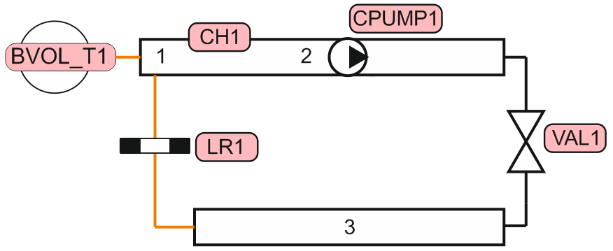
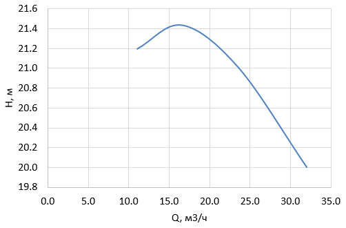
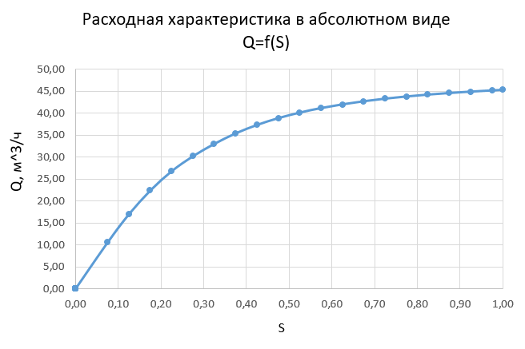
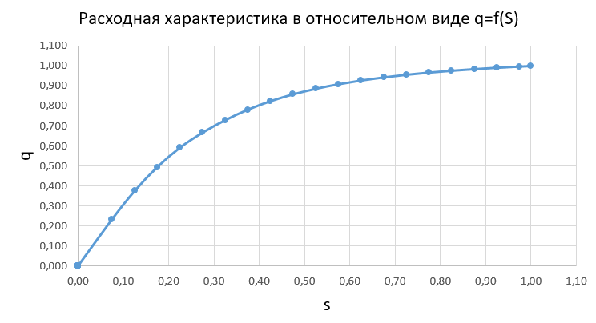
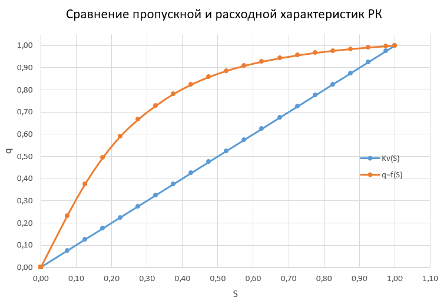
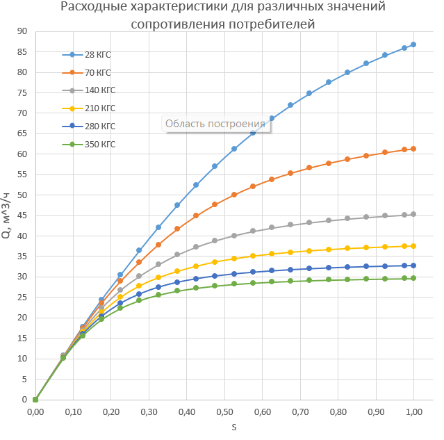
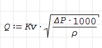

# Лабораторная работа №2. Определение расходной характеристики регулирующей арматуры при работе на реальную гидравлическую трассу.

## 1. Цель работы
Целью работы является получение расходной характеристики регулирующей арматуры при ее работе в гидравлической сети методом расчетного моделирования в системном теплогидравлическом коде КОРСАР. 
---
## 2. Описание постановки задачи
В задаче моделируется течение через регулирующий клапан (РК), установленный на участке трубопровода DN50 (длина ячеек канала составляет по 1 м, ячейка 3 канала имеет DN100) совместно с последовательной установленным гидравлическим сопротивлением (потребителем). Течение организовано при помощи задания характеристики насоса.
Параметры задачи представлены в таблице
|Параметр|Значение|
---|:---:|
|Температура потока |20°C|
|Давление на всасе насоса |1 МПа|
|$Kv_у$ клапана  |33|
|Пропускная характеристика  |Линейная|
|КГС местного сопротивления   |140|
---
## 3. Требуемые результаты
- Определить расходную характеристику РК в абсолютном и относительном виде ($q=f(s)$), сравнить с пропускной. Определение расходной характеристики произвести путем изменения положения рабочего органа РК и регистрации соответствующего расхода, протекающего через РК и дальнейшей нормировки (при необходимости).
- Исследовать изменение расходной характеристики РК в зависимости от КГС местного сопротивления в диапазоне -80%...+150% от заданной величины.
---
## 4. Ход выполнения работы
Для выполнения задачи были созданы файлы задачи kordat и обработки данных kutdat. 

Нодализация задачи представлена на рисунке ниже:



Характеристика насоса представлена на рисунке:



В качестве начальных условий принималось: давление в баке BVOL_T1 равное 1 МПа, температура теплоносителя 20 °C, паросодержание равно нулю (однофазное течение). Геометрия канала CH1 задана тремя ячейками (две по DN50 и одна DN100 длиной по 1 м). Потребитель LR1 задан коэффициентом гидравлического сопротивления (КГС), равным 140. Течение в контуре организовано при помощи задания характеристики насоса CPUMP1. Для этого в блоке DATA был активирован режим MODE = 2, а в процедуре EVENT _CalcSensor реализован алгоритм: на каждом шаге по времени считывался текущий массовый расход через канал, пересчитывался в объёмный, и по табличной характеристике     H(Q) с помощью функции интерполяции LINS определялся напор. Полученное значение напора (в Па) присваивалось ключу DP.CPUMP1.  

Для вывода расчетной схемы в квазистатический режим (открытие клапана) было выполнено плавное изменение положения штока регулирующего клапана VAL1. В процедуре EVENT _Actions реализован линейный закон открытия: начиная с 5-й секунды, положение штока S плавно увеличивалось от 0 до 1.0 в течение 200 секунд. Это позволило избежать численной неустойчивости из-за резких скачков.    

Вывод расчетных значений осуществляется с периодичностью 0.1 с в начальный период (до 3 с) и 10 с в основной период времени. В файл результатов записывались текущее время, положение штока клапана, расход через клапан, расход через насос и напор насоса. По полученным данным в дальнейшем были построены расходные и относительные характеристики клапана. 







Для выполнения второй части задания (исследование влияния КГС местного сопротивления) в файле задачи предусмотрено изменение ключей CSI1 и CSI2 элемента LR1 в блоке DATA _Lr. Диапазон варьирования составляет от −80% до +150% от базового значения (140). Расчетные значения КГС, используемые в серии запусков, приведены в таблице ниже:
|Вариант|Изменение|КГС|
---|:---:|---|
|   1  |    -80%   |    28  |
|   2  |    -50%   |    70  |
|   3  |    Исходный   |    140 |
|   4  |    +50%   |    210 |
|   5  |    +150%  |    350 |

Для каждого значения КГС выполняется полный цикл расчета с последующей обработкой результатов и построением абсолютной расходной характеристики Q(s). Все полученные кривые наносятся на один график для наглядного сравнения степени искажения расходной характеристики системы в зависимости от сопротивления сети.



## 5. Получение результатов работы
Для получения результатов необходимо:  
- выполнить запуск кода КОРСАР при помощи команды 
```cmd
START.bat task result
```
- после окончания расчета выполнить процессинг бинарного фалйа результатов расчета _korres_ при помощи команды  
```cmd
PROC.bat task result
```
- обработка результатов расчета выполнена в табличном редакторе (Microsoft Excel). Полученный текстовый файл с данными (столбцы: время, положение штока, расход через клапан, расход через насос, напор) импортируется в Excel. Далее средствами Excel производится нормировка расхода (деление на максимальное значение) и построение графиков расходных и относительных характеристик. [Скачать Excel-файл.xlxs](./Graph.xlsx)

## 6. Валидация результатов расчета
Для проверки достоверности полученных результатов была проведена независимая оценка расхода через регулирующий клапан с использованием классической формулы пропускной способности (оценка $Kv$ ):  
  
    где Q — объёмный расход (м³/ч), $Kv$ =33 — условная пропускная способность клапана, ΔP — перепад давления на клапане (бар), ρ — относительная плотность среды (для воды ρ≈1000 кг/м³)

Исходные данные для валидации (при полностью открытом клапане, S=1):
Из результатов численного эксперимента по коду КОРСАР были взяты значения давлений в расчетных ячейках, примыкающих к клапану (при t=210 с):

- Давление в ячейке до клапана (ячейка 2): 
P2 = 0.990222 МПа ≈ 9.90 бар.

- Давление в ячейке после клапана (ячейка 3): 
P3 = 1.17960⋅10 МПа ≈ 11.80 бар.

Расчёт был произведён в SMath Solver [Скачать файл SMath Solver](./valid.sm)

Расхождение расчетного значения по коду КОРСАР (45.25 м³/ч) с оцененным по формуле (45.42 м³/ч) составляет менее 0.4%. Такое незначительное расхождение может  объясняться округлением значений давлений при расчёте по представленной ранее формуле.

## 7. Список литературы
1. Э.Е.Благов, Б.Я.Ивницкий Дроссельно-регулирующая арматура ТЭС и АЭС. - М.: Энергоатомиздат, 1990. - 288 с.: ил.
2. РТМ 108.711.02-79 Арматура энергетическая. методы определения пропускной способности регулирующих органов и выбор оптимальной раходной характеристики
3. КОРСАР/В3. Руководство пользователя (https://korsar.niti.ru)

## Сокращения и обозначения
DN - условный проход
Kv - пропускная способность клапана
Q - объемный расход
s - относительное положения рабочего органа
КГС - коэффициент гидравлического сопротивления
РК - регулирующий клапан
РО - регулирующий орган